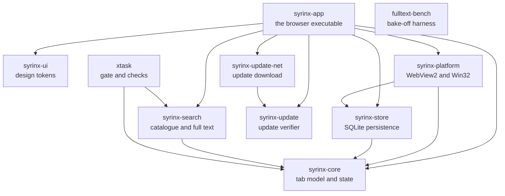

# How the Syrinx workspace is built

This page is a guided tour of Syrinx's Rust code for someone new to Cargo
and to this stack: which crates exist, what each one owns, which outside
libraries they lean on, which of those are patched, and how a build and the
gate run. It explains; it does not decide. The decisions live in
[`docs/decisions.md`](decisions.md) (the owner's, which win) and
[`docs/architecture-decisions.md`](architecture-decisions.md) (D1–D49, each
with what was rejected). The wiki's [Architecture](../wiki/Architecture.md)
page covers the runtime picture in more depth (how pages render, storage,
search tiers, updates); this page leans on it rather than repeating it. If
this page disagrees with any of those, they are right and this page is
stale.

Everything below was read from the repository on 2026-10-25. Anything not
built yet is marked **planned**.

## A few words first

These terms come up throughout. Each is explained once here.

| Term | What it means here |
|---|---|
| **Crate** | Rust's unit of compilation: a library or a program with its own `Cargo.toml`. Each folder under `crates/` is one crate. |
| **Cargo workspace** | A set of crates built together, sharing one `Cargo.lock`, one `target/` folder and common settings. Syrinx's is defined by the root `Cargo.toml`. |
| **Feature** | An optional switch in a crate's `Cargo.toml` that turns extra code on at compile time, for example `rusqlite`'s `bundled`. Syrinx usually sets `default-features = false` and lists only the features it needs, so nothing unexpected compiles in. |
| **Lockfile** | `Cargo.lock`, the exact version and checksum of every crate in the build, direct or transitive. It is committed; the gate builds with `--locked`, so Cargo refuses to change it silently. |
| **Vendored patch** | A copy of an outside crate kept in this repository under `vendor/`, with a small reviewed change. The root `Cargo.toml`'s `[patch.crates-io]` tells Cargo to use that copy instead of the published one. |
| **xtask** | A common Rust convention: development scripts written as an ordinary crate (`crates/xtask`) and run with `cargo xtask ...`, so they need nothing beyond Rust. |
| **WIT** | WebAssembly Interface Types, a small language that describes the functions and values crossing between a host and a WebAssembly plugin, so both sides' code is generated from one definition. |
| **wasmtime** | The WebAssembly runtime Syrinx will embed to load and sandbox plugins (owner decision, 2026-10-21). **Planned**: it is not in the workspace yet. |

## 1. The picture

Syrinx is one Windows program with one main window. Each web page is a
**WebView2** child window (the Chromium engine Windows ships) that Syrinx
places inside its rounded "page card", driven from Rust through the **wry**
library and, where wry has no API, through WebView2's own bindings
(`webview2-com`). Everything around the card, and the palette and sidebar
peek that float over it, is drawn by **GPUI**, the GPU-accelerated Rust
toolkit Zed's editor is built on, with the `gpui-component` widget set.
There is no JavaScript application in between: the interface calls the Rust
core directly.

Rust owns all state. `syrinx-core` holds the one generic tab model, the
session and the command table, with no window or browser engine in sight.
`syrinx-store` persists it to one local **SQLite** database through
rusqlite. `syrinx-search` ranks open tabs, saved pages, history and commands
in memory with the frizbee fuzzy matcher on every keystroke, and holds the
Tantivy full-text index for page text. `syrinx-platform` is the only crate
that touches WebView2 and Win32. Plugins (Notes first, then Forge) will be
**WebAssembly components** in their own repositories, loaded and sandboxed
by a host crate built on wasmtime; that part is **planned** (section 6).

## 2. The crates

The root `Cargo.toml` makes every folder under `crates/` a member
(`members = ["crates/*"]`), excludes the four vendored packages, and sets
`default-members = ["crates/syrinx-app"]`, so a bare `cargo build` builds
the browser. Every crate inherits version `0.1.0`, Rust edition 2024, a
minimum Rust of 1.97, `publish = false` and the MPL-2.0 licence from
`[workspace.package]`, and the shared lints from `[workspace.lints]`.
Outside versions are declared once, in `[workspace.dependencies]`, and each
crate opts in with `name.workspace = true`, so two crates can never ask for
different versions of the same library.

### How they depend on each other

This diagram is drawn from the `[dependencies]` tables of each
`crates/*/Cargo.toml`. An arrow means "depends on".

`syrinx-core`, `syrinx-ui` and `syrinx-update` depend on no other Syrinx
crate, and `fulltext-bench` stands alone. Development-only dependencies are
left out: `syrinx-app` and `syrinx-platform` also use `rusqlite` in tests.

### syrinx-app

"Opens the integrated browser and keeps its native workers alive through
orderly shutdown." This is the `syrinx` executable: the window, sidebar,
page card, Home, palette, Settings, and the session worker that saves
changes as they happen. It also builds `syrinx-setup`, the per-user
installer (`docs/installing.md`). It is the only crate that wires
everything together.

- **Syrinx crates:** all seven product crates.
- **Outside crates:** `gpui` (published as `gpui-pre`), `gpui_platform`
  (`gpui-pre-platform`), `gpui-component`, `futures`, `raw-window-handle`,
  `url`.
- **Feature:** `installed`, set only by `cargo xtask package`, so an
  installed Syrinx keeps its data apart from development runs.

### syrinx-core

"Owns Syrinx's application state independently of its interface and browser
engine." The generic tab model, saved pages and folders, the closed-tab
history, address handling, bookmark import, commands and the local usage
counts (D39). Because it knows nothing of windows, it is tested with plain
Rust tests.

- **Syrinx crates:** none.
- **Outside crates:** only `url`, approved by the owner on 2026-10-12 so
  navigation and import share one address rule.

### syrinx-store

"Persists Syrinx state through a checked storage location and a serialized
writer." SQLite through rusqlite: schema migrations, settings, saved pages,
history, permissions, site zoom, the daily snapshots (D13) and the deletion
journal that stops a restored snapshot bringing back cleared history (D47).

- **Syrinx crates:** `syrinx-core`.
- **Outside crates:** `rusqlite` with `bundled` (SQLite compiled in, from
  the patched `libsqlite3-sys`) and `cache`; `rusqlite_migration`.

### syrinx-search

"Syrinx's local search: the in-memory catalogue (tier 1) and the full-text
index (tier 2)." The catalogue ranks metadata without any file access; only
its `fulltext` module reads and writes files.

- **Syrinx crates:** `syrinx-core`.
- **Outside crates:** `frizbee` (patched) and `tantivy` 0.27.0, chosen over
  SQLite FTS5 by the P1-23 bake-off (#52). The adapter that feeds page text
  into the index is #53.
- **Feature:** `acceptance-diagnostics`, opt-in timing output for the
  100,000-row acceptance workload.

### syrinx-ui

"Syrinx's design tokens as plain data, so the chrome draws every colour and
size from one place." Palettes, the accent colour, contrast checks, metrics
and sidebar widths. It has no toolkit dependency at all; `syrinx-app`
converts its colours to GPUI's.

- **Syrinx crates:** none. **Outside crates:** none.

### syrinx-platform

"Confines Windows storage, page, single-instance, calendar, Edge, icon,
disk, backdrop, caption and setup services to the platform boundary." Every
WebView2 page host, the storage-folder checks that keep the database out of
synced folders, the single-instance pipe, and the Win32 window details. Its
`examples/page_close` is the native fixture that drives real WebView2 pages.

- **Syrinx crates:** `syrinx-core`, `syrinx-store`.
- **Outside crates:** `wry` (patched), `webview2-com`, `windows` with a long
  explicit feature list, `raw-window-handle`, `futures`, `serde_json` (for
  DevTools page-text snapshots).

### syrinx-update

"Local verification of signed update packages and latest statements, and
the staging and install steps built on it": no download, network call or
interface (`docs/update-format.md`). It builds `syrinx-apply`, the helper
that swaps an update in after Syrinx exits, and `syrinx-update-tool`, the
release signer.

- **Syrinx crates:** none.
- **Outside crates:** `windows`, limited to `Win32_Foundation` and
  `Win32_Security_Cryptography`.
- **Feature:** `release-tool`, which links Windows key storage for signing.
  Only the release tool enables it; the gate refuses any crate that turns it
  on for Syrinx itself.

### syrinx-update-net

"Downloads Syrinx's update files from the one compiled-in host over
WinHTTP, and only when the owner presses 'Check for updates'"
(`docs/update-delivery.md`). It is the single exception to D9's rule that
Syrinx makes no network call on its own.

- **Syrinx crates:** `syrinx-update`.
- **Outside crates:** `windows` with exactly `Win32_Networking_WinHttp`.
  It deliberately has no `[features]` table, so no build can redirect it.

### xtask

"Runs the local development gate and checks the workspace's dependency
boundaries." Section 5 describes what it runs.

- **Syrinx crates:** `syrinx-core`, `syrinx-search` (for the benchmark and
  palette acceptance commands).
- **Outside crates:** `serde_json`, to read `cargo metadata`.

### fulltext-bench

"Compares disposable synthetic full-text caches; no product crate uses this
harness." The P1-23 bake-off between Tantivy and SQLite FTS5. The gate
refuses any crate that depends on it.

- **Outside crates:** `rusqlite`, `tantivy`.

### The boundaries are checked, not hoped for

`cargo xtask check-deps` reads Cargo's metadata and fails the gate when a
crate reaches past its layer. The main rules, from
`crates/xtask/src/dependency_policy.rs`:

| Rule | Why |
|---|---|
| Only `syrinx-app` and `syrinx-ui` may depend on GPUI (`syrinx-ui` uses none today). | The core stays testable without a window. |
| Only `syrinx-platform` may depend on `wry`, `webview2-com` or raw Win32; `syrinx-update` and `syrinx-update-net` may use `windows` with their exact feature lists. | Windows code stays in one place. |
| `syrinx-core`, `syrinx-store`, `syrinx-search`, `syrinx-update` and `syrinx-update-net` must not reach shell crates even indirectly. | Same reason, through the whole graph. |
| Only `syrinx-search` and `fulltext-bench` may use Tantivy; nothing may use `fulltext-bench`. | Keeps the bake-off out of what ships. |
| No crate may declare a network client or a Windows networking feature, except WinHTTP in `syrinx-update-net`, which only `syrinx-app` may use. | D9: keystrokes and browsing stay on the machine. |

`docs/dev/LOCAL-DEV.md`, "What the architecture check protects", lists the
rules in full.

## 3. Vendored and patched dependencies

Four outside crates are copied into `vendor/` and patched, each with the
owner's narrow approval recorded in `AGENTS.md` ("Dependencies and
licence"). Each has a provenance file beside it recording the published
archive's checksum, the exact files changed and their hashes. Most changes
also have a review in `docs/dev/vendor-reviews/`; the table says where each
one's explanation is.

| Crate | Why it is patched | Where the record is |
|---|---|---|
| `wry` 0.57.0 | Two patches. Published wry destroys a page's native window as soon as the page asks to close, before Syrinx can save that the tab closed; the first patch hands the request to Syrinx's session worker instead. The second keeps temporary owners alive while a web view is being built, so a failed construction cleans up properly. | `vendor/wry-0.57.0.provenance.md`; `page-close-event-review.md` and `wry-failed-construction-patch-review.md` |
| `gpui-pre-windows` 0.3.8 (GPUI's Windows backend, pulled in by `gpui-pre-platform`) | Two patches. Unpatched, GPUI repaints every window on every display refresh, about 3.75% of a core while idle; the idle patch repaints only when something changed (D37). The 2026-10-14 patch embeds precompiled shaders in every profile, because with debug assertions on GPUI compiled them at run time from the build machine's source folder, so preview v0.1.0 started nowhere else. | Idle patch: `gpui-idle-patch-review.md` and `p1-06-gpui-idle-results.md`. Shaders patch: no review file; it is explained in `vendor/gpui-pre-windows-0.3.8.provenance.md`, "Embedded shaders patch (2026-10-14)". |
| `frizbee` 0.13.0 | A three-file fix so the fast ASCII scoring path never scores the padding past a field's real text, which returned highlight positions beyond the string for some queries. | `vendor/frizbee-0.13.0.provenance.md`; `p1-05-frizbee-maintenance-review.md` |
| `libsqlite3-sys` 0.38.2 | The Rust wrapper is unchanged; its bundled SQLite is replaced with 3.53.4 for journal, write-ahead-log and corruption-check fixes that crash recovery relies on when it inspects a possibly damaged database. | `vendor/libsqlite3-sys-0.38.2.provenance.md`; `p1-04-sqlite-maintenance-review.md` |

Each Syrinx-authored patch (two for wry, two for GPUI, one for frizbee) has
an upstream-ready `*.patch` file beside it, so it can be offered back to the
project; sending one needs the owner. The SQLite update has none, because it
is not Syrinx's diff: its four files are copied from rusqlite's own upstream
SQLite 3.53.4 import, as its provenance file records.
Unchanged upstream `TODO` comments and lint annotations are allowed only
inside these vendored folders.

## 4. Pins, and why GPUI and wasmtime use `=`

Every version in `[workspace.dependencies]` is written with `=`, such as
`gpui-pre = "=0.3.8"`, which means "exactly this version". A plain `"0.3.8"`
in Cargo means "0.3.8 or any compatible later release", which Cargo would
pick up the next time the lockfile is regenerated.

- **GPUI** is published as weekly snapshots of Zed's source, and a
  snapshot may change the API. A compatible-version requirement has already
  moved apps onto a snapshot their widgets did not compile with (research
  note 08, section 1.2). GPUI, `gpui-pre-platform` and `gpui-component` are
  therefore pinned exactly, and moving the pin needs the owner.
- **wasmtime (planned)** will be pinned on its 48.x long-term-support line,
  supported to about 2028-08, rather than following its monthly major
  releases (`docs/decisions.md`, 2026-10-21). A security patch within 48.0.x
  is a routine pin bump that must pass the gate; leaving the 48 line needs
  the owner. The audit for the intended pin, `=48.0.7`, is in
  `docs/dev/wasmtime-audit.md`; nothing is in `Cargo.toml` yet.
- **wry and `webview2-com`** are pinned exactly too, and moving them needs
  the owner, because the wry patch and the page-web-view rules depend on
  their exact behaviour.

The lockfile pins everything else, transitive crates included; changes that
shift many of them need the owner (`AGENTS.md`, "Environment and the
owner's machine").

## 5. How a build and the gate run

### The `local` profile (D38)

A Cargo **profile** is a named set of compiler settings. Syrinx builds,
tests and runs with its own `local` profile, defined in the root
`Cargo.toml`. It inherits `release` (optimized), but keeps debug assertions
and overflow checks on and line-number debug information, so tests still
catch mistakes. It exists because Windows' Smart App Control blocked
unoptimized debug builds during Phase 0, and the owner keeps Windows'
security settings unchanged. `[profile.local.build-override]` also
optimizes build scripts, which Cargo would otherwise leave unoptimized.

`.cargo/config.toml` gives two aliases, both `--offline --locked --profile
local`: `cargo syrinx` runs the browser and `cargo xtask` runs the tools. It
also links the C runtime statically, so a copied Syrinx needs no Visual C++
redistributable. Building needs the Windows SDK: `rc.exe` for the icon and
`fxc.exe` for GPUI's shaders (`docs/dev/LOCAL-DEV.md`).

### `cargo xtask check`, step by step

The gate (`check_workspace` in `crates/xtask/src/main.rs`) stops at the
first failure.

| Step | What it does |
|---|---|
| `check-deps` | The dependency-boundary and network rules in section 2, from `cargo metadata`, plus a source scan for network use. |
| `check-deferred` | Every `TODO`, `FIXME` or `HACK` under `crates/` must name an issue listed in `docs/dev/deferred-work.md`. |
| `check-packaging` | The registry script and the table in `docs/installing.md` must match the Rust table they are generated from, and the packaging PowerShell scripts must parse and avoid forbidden text. |
| `cargo fmt --all -- --check` | Formatting. |
| `cargo clippy --workspace --all-targets ... -D warnings` | Lints, with every warning an error, built without the release tool. |
| `cargo test --workspace ...` | All tests, including doc tests. |
| `clippy` and `test` on `syrinx-update --features release-tool` | The release signer on its own, so its feature never reaches the app. |
| `cargo run --package syrinx-app ... -- --smoke` | Opens a real window and an `about:blank` page in a fresh temporary profile, then shuts down cleanly; a watchdog fails it after 30 seconds. |

Other `xtask` commands: `package` (the setup program and portable zip under
`target\package`), `sign-update`, `write-registration`, `bench` and
`palette-acceptance` (P1-33's palette and focus acceptance, run in the real
app against synthetic local pages).

### On GitHub

- **`.github/workflows/gate.yml`** runs `cargo xtask check` on every pull
  request and every push to `main`, on a `windows-latest` runner with Rust
  1.97.1, through `.github/scripts/run-gate.sh`. A separate Linux job checks
  formatting in a minute or two.
- **`.github/workflows/weekly-release.yml`** runs every Thursday at 10:00
  New York time, skipping a week with no new commits. It sets the version,
  runs the same gate, builds the package, captures screenshots on synthetic
  data, writes release notes from `main`'s commit subjects, publishes a
  GitHub release and updates syrinxapp.dev. See `docs/releasing.md`.

## 6. Where plugins fit

None of the plugin system is built in this workspace yet. What is decided:

- **Plugins live outside this workspace.** Each is its own repository made
  from the template,
  [`Fledge-Software/syrinx-plugin-template`](https://github.com/Fledge-Software/syrinx-plugin-template)
  (#30), and built-in plugins ship as signed packages bundled in Syrinx's
  release. The Notes plugin (#35) lives in `Fledge-Software/Syrinx-Notes-Plugin`,
  a repository that is private for now,
  made from that template; Forge (#42) follows once Notes is in daily use.
  The Fledge plugin (#32) is on hold.
- **The host is planned as `crates/syrinx-plugin-host`** (#28): the only
  crate that will link wasmtime. It will load and run plugins, enforce the
  capabilities the owner grants, and publish a test host library that
  plugin repositories run their contract tests against. It does not exist
  yet, and wasmtime is not in `Cargo.toml` or `Cargo.lock`.
- **The contract is planned as one WIT package, `syrinx:plugin`, world
  `plugin`, at `wit/v0_1/`** at the repository root, which `xtask` will
  parse in the gate. That folder does not exist yet; the draft was checked
  outside the repository (`docs/dev/vendor-reviews/wasmtime-wit-prebuild-check.md`).
- **Plugin views** are planned as a separate type in `syrinx-platform`,
  apart from page web views, and are the only web views that may talk to
  Rust.

The order, the capability model and the rejected alternatives are on the
wiki's [Plugin system](../wiki/Plugin-system.md) page; the runtime research
is `docs/dev/background-10-wasm-plugin-runtime-draft.md`.

## 7. The rules that shape the code

Each is one line here; [`AGENTS.md`](../AGENTS.md) has the full rule and
reason.

- **No IPC handler, custom user agent or injected script on a page web
  view**, because Google blocks sign-in for that kind of tampering
  ([Guardrails](../AGENTS.md#guardrails-product-wide-and-load-bearing)).
- **Licence policy:** Syrinx is MPL-2.0; outside code is MIT, Apache-2.0 or
  BSD, or whole MPL-2.0 files, with a few named exceptions and no GPL
  ([Dependencies and licence](../AGENTS.md#guardrails-product-wide-and-load-bearing)).
- **Dependency audits:** every new crate, and every crate it brings, is
  checked for maintenance, security and licence first, as in
  `docs/dev/dependency-audit.md` and `docs/dev/fulltext-audit.md`
  ([Ask before proceeding](../AGENTS.md#guardrails-ask-before-proceeding)).
- **Deferred-work markers** must name a GitHub issue listed in
  `docs/dev/deferred-work.md`, and the gate refuses any that do not
  ([Where outstanding work goes](../AGENTS.md#where-outstanding-work-goes)).

## 8. Where to look next

- [`docs/dev/LOCAL-DEV.md`](dev/LOCAL-DEV.md): running the app and the gate on this machine.
- [`docs/dev/trapstoknow.md`](dev/trapstoknow.md): mistakes that pass the gate and fail elsewhere.
- [`wiki/Architecture.md`](../wiki/Architecture.md): how pages render, storage, search and updates.
- [`wiki/Plugin-system.md`](../wiki/Plugin-system.md): the plugin decisions and order of work.
- [`docs/architecture-decisions.md`](architecture-decisions.md): D1–D49 with their alternatives.
- [`docs/decisions.md`](decisions.md): the owner's decisions since the spec.
- [`docs/dev/vendor-reviews/`](dev/vendor-reviews/): every vendored patch, reviewed.
- [`docs/dev/dependency-audit.md`](dev/dependency-audit.md) and [`docs/dev/wasmtime-audit.md`](dev/wasmtime-audit.md): the audits.
- [`docs/releasing.md`](releasing.md): how the weekly preview is made.
- The root [`Cargo.toml`](../Cargo.toml) and [`crates/xtask/src/main.rs`](../crates/xtask/src/main.rs): the sources for most of this page.
